# How Kiftet Works — data flow

> Part of the [how-it-works index](README.md). This is the largest sector: every feature drawn as a numbered flow you can trace with your eye.


Every feature down the page is drawn as a **numbered visual flow**. The boxes
are in the exact order things happen, and each arrow shows the step that comes
next — follow the numbers and the arrows and you can *retrace* the whole
feature. Under each diagram you'll find the exact messages the programs
exchange (`Sending:` / `Receiving:` / `Data kept:`), and a one-line `Trace:`
key so you never lose your place.

GitHub and most editors render these diagrams automatically. If yours doesn't,
the numbering still tells you the order, and the `Trace:` line is there as a
plain fallback. Plain words are used only where a picture adds nothing —
tables for data structures, endpoints, and AI prompts.

## The flows chapter by chapter

### The components (a quick reminder)

Four programs cooperate, and exactly two of them talk to the outside world:

1. **Browser UI** — the screens the student sees and taps. It also captures the
   microphone.
2. **Backend API** — the server. It receives requests, does the thinking, saves
   and reads data, and answers.
3. **Database** — permanent storage. What survives after the phone is closed.
4. **Voice provider (browser Web Speech)** — hears the student and talks back.
5. **AI model (Gemini)** — does the reasoning: understanding the spoken
   explanation, spotting gaps, writing the lesson, grading retests.

So the student only ever touches the **Browser**, the Browser talks to the
**Server**, and the Server calls both the **AI** and the **Database**.

---

### 5.1 The complete study loop (overview)

One study session moves through five screens, in this fixed order:

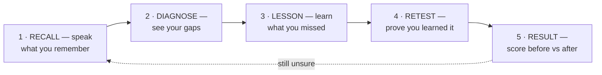

> **Trace:** recall → diagnose → lesson → retest → result (and, if unsure, back
> to recall).

Some rules that keep this simple:

- The **browser decides** when to move from one screen to the next. The server
  never pushes; it only answers requests.
- If the student didn't improve, the loop can go back to step 1 — a fresh
  recall — or loop inside step 4 (retest again) / step 3 (relearn).

---

### 5.2 Chapter ingest — putting content into the system

The student saves the **whole textbook record and its table of contents first**,
then selects chapters from a user-facing hierarchy. Internal text-size splits
are hidden from that tree: one selected chapter can become multiple ingest
rows, but the student sees and chooses the book's chapter, not processing
chunks.

Two ways content gets in:

- **Seeded/demo content** — the demo (and any seeds) load chapters directly on
  the server (see [the roadmap](roadmap.md)).
- **The student's own textbook (Phase 6)** — the student uploads their book
  (PDF up to **15 MB**, or pasted text) from the app. The browser reads PDF
  text and bookmarks locally. When a PDF has an unreadable text layer, it
  recognizes the contents pages and chapter bodies with on-device Tesseract
  OCR; the file bytes never leave the phone. Numbered contents entries provide
  unit topics and, when printed-page alignment is corroborated by detected
  chapter starts, chapter page ranges. If contents OCR or alignment is not
  trustworthy, the importer falls back to headings extracted from the book.
  Readable PDFs continue to use their outline/bookmarks and text headings. The
  account stores the textbook metadata and nested TOC before any chapter is
  imported. The original PDF stays in browser IndexedDB on that device; if it
  is unavailable later or the student uses another device, they reselect it.
  Only a selected chapter's extracted text and optional topic labels are sent
  for ingest. Imported chapters remain in the account library and appear as
  already added in the TOC.

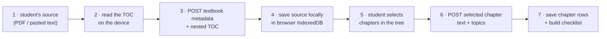

> **Trace:** file → device reads the TOC and extracts text → `POST /textbooks`
> saves the owned book and tree → original source stays in local IndexedDB →
> student selects chapters → `POST /chapters/ingest` sends only selected text
> and topics → chapter rows and checklists persist for future sessions.

```
Save book: { title, subject, language, sourceName, sourceSize, toc }
Response:  { textbookId }
Ingest:    { textbookTitle, subject, language, title, rawText, topics? }
           topics = [{ path, title, page }]  — the book's own numbered lines
Data kept: textbook (1 + nested toc) → chapter (1+, topics stored, extractedAt null)
           → concept_node (the book's topics, seeded at import)
```

When `topics` are supplied from a book's contents, their titles and numbering
lead the checklist in the order the book lays them out. **They are the whole
checklist at import time**: `POST /chapters/ingest` no longer calls the model, so
no AI is spent on chapters the student may never open — the failure-and-fallback
behaviour that used to live here now lives in the deferred read below.

The deferred read. The first time a chapter is actually used —
`POST /sessions/start`, `GET /chapters/:id/concepts`, or
`GET /chapters/:id/objectives` — the server reads it once
(`ensureChapterExtraction`): the model's concepts are merged under the book's
topics (misconceptions and detail the contents left out survive), the book's own
stated objectives are stored, and `chapter.extractedAt` is stamped so it never
happens twice. It is best-effort: if the model is busy or throttled the request
still succeeds with the topic-only checklist, and a deterministic fallback is
never stamped as a real read, so a later visit retries the model.

---

### 5.3 Starting a study session

Here's the order when a student picks a chapter:

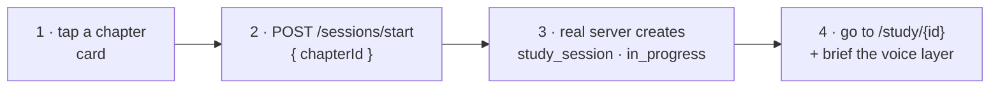

> **Trace:** pick chapter → server opens a session → return `sessionId` →
> navigate to the study screen.

```
Sending:   { chapterId }
Receiving: { sessionId }
Data kept: study_session (1 row, status = "in_progress")
```

No AI call happens here — it's just bookkeeping. All study screens for the rest
of the session use this `sessionId`.

---

### 5.4 Recall — "what do you remember?"

This is the heart of the product. The student speaks out loud; the system
grades their explanation against the concept checklist:

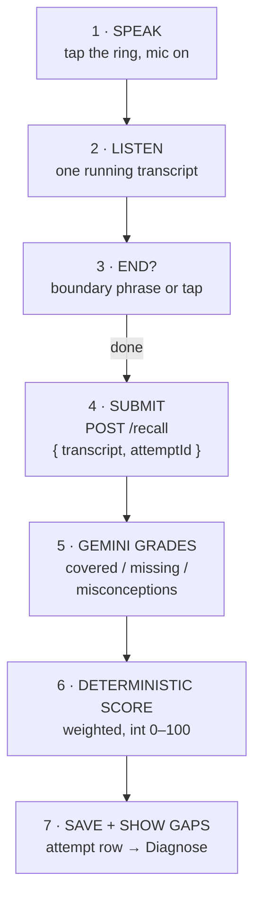

> **Trace:** speak → listen → detect the end → submit → Gemini grades →
> deterministic score → save + show gaps.
>
> **Data kept:** attempt (1 row, stage = "recall")

```
Sending:   { transcriptText, attemptId }
Receiving: { gaps: { mastery: {...}, covered: [...], missing: [...], misconceptions: [], score: 60, estimated: false } }
```

A few things worth knowing:

- **Subject-family-aware grading:** the chapter's `subject` is looked up and
  passed to `gradeRecall`, which injects family-specific directives into the
  system prompt (e.g. Mathematics → "focus on method/reasoning steps, not just
  the answer"; CS/ICT → "trace control flow; don't penalize syntax"; English →
  "assess usage in context"). Defined once in
  `apps/server/src/ai/subject-strategy.ts` and mirrored for client hints in
  `apps/web/src/lib/subject-strategy.ts`.
- **What's graded:** every concept gets a **level** — `0` not addressed, `1`
  raised but not explained, `2` explained wrong, `3` explained correctly — in
  `gaps.mastery`. The `covered` / `missing` / `misconceptions` lists you see are
  **derived from those levels**, so the per-concept view and the single number
  can never disagree. `covered` = level 3 (and 1), `misconceptions` = level 2,
  `missing` = level 0.
- **The score is a weighted roll-up of the levels**, not a separate judgement:
  level 3 earns full weight, level 1 earns half, level 2 earns **nothing** —
  a student who states a wrong belief is not credited for it. Higher-weight
  concepts count more.
- **`estimated: true`** means this came from the deterministic fallback (no AI
  key, or Gemini failed/rate-limited). It can see which ideas were mentioned
  but not whether they were explained, so it caps at level 1 and the number is
  an estimate. The UI labels it. Don't treat it as a real grade.
- **Idempotency:** because every submission carries a random `attemptId`, a
  double-tap, a retry, or a network replay can never create a phantom second
  attempt. The dedup is scoped to the session.
- **Restore on refresh:** if the student reloads the page, the screen rebuilds
  itself from the saved attempts instead of asking the student to recall a
  second time.

**Auto-end detection** details live in section 5.12 below.

---

### 5.5 Diagnose — "here's what's missing"

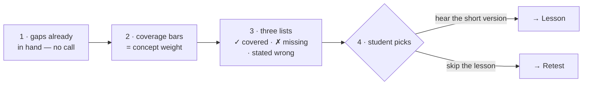

> **Trace:** gaps in hand → weighted bars → three lists → student chooses the
> path. Nothing is saved in this phase — it's a read-only screen.

---

### 5.6 Microlesson — "learn what you missed"

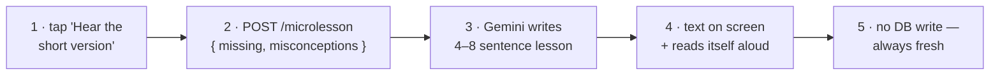

> **Trace:** tap → generate the lesson → show it → speak it. Nothing is saved;
> the lesson is always freshly generated for the specific gaps.

```
Sending:   { missing: [...], misconceptions: [...] }
Receiving: { text: "When current flows through two paths..." }
Data kept: nothing — pure AI generation
```

The read-aloud step uses the agent's natural voice when available, otherwise
the browser's TTS from the "Read it to me" button (see 5.11).

#### 5.6b Guide — the cached, ordered sections (phase 11, 3b)

The microlesson above is a *per-session* read-aloud script. The **guide** is the
other half: the structured sections the student actually reads, in the order
*this* student needs them. They are fetched alongside the microlesson, in
parallel.

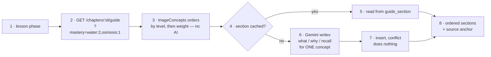

```
Sending:   GET /chapters/:id/guide?language=en&mastery=<urlencoded levels>
Receiving: { sections: [{ conceptText, weight, level, what, why, recall,
                         sourceOffset, sourceQuote, estimated, needsWork }],
            estimated, language }
Data kept: one row per (chapter, concept, language) in `guide_section`
```

Two things make this affordable, and they are the whole point:

- **The unique constraint `(chapter_id, concept_text, language)` is the cache.**
  The second student on a chapter generates nothing. Measured: first guide 4 AI
  calls, second guide 0.
- **Ordering costs nothing.** `triageConcepts` reads the mastery map the
  server already has. The model is never asked what to study next, so it cannot
  contradict the diagnosis screen the student just looked at.

**The ladder, per section** (a failure costs one section, never the guide):

1. Valid JSON → store it.
2. Timeout / 429 / malformed → deterministic section from the concept plus the
   overlapping chapter sentence, flagged `estimated: true`. It cannot translate,
   so it never copies the book sentence into a non-English guide; the scaffolding
   is in the requested language and the book is quoted verbatim underneath.
3. Nothing at all → the checklist concept and its weight. The checklist is the
   skeleton, so a chapter with no prose is still a usable revision list.

`sourceOffset` is computed by lexical overlap against `chapter.rawText`, never
asked of a model — a model asked for a location invents one.

---

### 5.6c Study plan — a roadmap, one card per diagnosed gap

The study plan follows diagnosis; it does not replace, re-grade, or re-quiz it.
That was the v0 mistake: the planning screen asked the student to answer the very
gap the diagnosis had just concluded they have. The plan is a **roadmap**: it
says what to study, in what order, and where to go.

The client sends the existing mastery map and the student's selected 10/20/40
minute budget to `POST /sessions/:id/plan`. Selection is deterministic and free:
levels 0/1/2 become *Learn it* / *Complete it* / *Tell them apart*; the
highest-value concepts that fit the budget are chosen (misconceptions first, then
book order), capped at five steps. Unselected gaps remain under "Next session";
level-3 concepts are reported as known rather than assigned another step.

Each card points to a deterministic excerpt and offset in that student's own
chapter (computed, never hallucinated), and carries a **deterministic search
query** — concept + subject + a subject-shaped suffix — that the *client* turns
into a YouTube or Google search link. The server never invents a URL.

Only the one-line *why this is yours* is generated: a single batched provider
call (`generatePlanWhyFirst`) writes one short orienting line per step from the
concept, failure mode, and the student's own words. The chapter's subject is
passed so the prompt carries family-specific directives (from
`subject-strategy.ts`). If the model is unavailable the line falls back to the
deterministic diagnosis ("Not in your recall — start here."), and `estimated`
marks when any line fell back. The plan is the same for a given diagnosis and
budget regardless.

Progress is a **tick-through checklist**, not an attempt: cards mark done for the
session (`sessionStorage`), and `plan-progress` shows *n of m done*. The old
`POST /sessions/:id/plan/check` endpoint and the `plan_content` /
`plan_step_check` tables are unused. After the last card, the existing retest
starts — the only graded step. The dashboard's optional "Review due" chip uses
the most recent saved mastery check and a two-day threshold; it sends no
notification.

---

### 5.7 Retest — "prove you learned it"

The retest has two parts: generating questions, then grading each answer. Two
design goals matter above all: **each question is graded alone against exactly
one focus** (so getting one right can't secretly help the others), and the
questions are an **exam-readiness check, not a re-quiz** — never easy, tagged
with a cognitive level, six to ten in number, and carrying exactly one scenario
beyond the textbook. The writer is grounded in the chapter's own text and told
which ideas the recall sweep never judged (`unprobed`), so it cannot substitute
a narrow quiz for the chapter-wide proof.

**Part A — Generate the questions:**

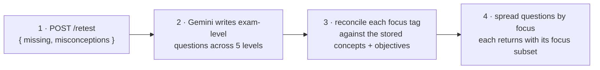

> **Trace:** ask for questions → Gemini writes them at exam level → tags are
> verified against the real concepts *and* the chapter's stated objectives →
> canonical focus returned. (Case/whitespace tolerant; an unverifiable
> `targetConcept` falls back to the question's `targetObjective`, then to the
> gap list — a question never grades against a made-up idea.)

```
Sending:   { missing: [...], misconceptions: [...], objectives: [...] }
Receiving: { questions: [ { question: "...", level: "application",
                            focus: ["..."], beyondText?: true }, ... ] }
```

> **One corrective pass, not a silent soft set.** If the parsed set climbs fewer
> than three cognitive levels or carries no beyond-textbook question,
> (`retestIsSoft`), the writer is re-asked once with a corrective instruction.
> The repaired set replaces the first only when it is no longer soft; otherwise
> the signal is counted and logged. `enforceSingleBeyondText` clears any extra
> beyond-text flags, so "exactly one" is a contract rather than a hope.

> **Exam-readiness, not a mirror.** Earlier the retest echoed the student's own
> recall wording; that made it a quiz on their phrasing and collapsed the
> before/after delta, so it was reversed (decision #19). The writer now receives
> the gap list *and* the chapter's stated objectives, and is told the questions
> must never be easy, must include fine detail, must climb all five cognitive
> levels (`knowledge` → `compare_contrast`, from
> `apps/server/src/ai/questions.ts`), and must include exactly one `beyondText`
> scenario the chapter doesn't cover. The chapter's subject is still passed,
> injecting family-specific directives. (`RETEST_SYSTEM` / `questionUserPrompt`
> in `apps/server/src/ai/gemini.ts`.)

### 5.7b Recall modes — blurting, targeted, or both

The student picks how they want to remember **before** anything is generated;
`study_session.recall_mode` persists the choice so a reload keeps the same loop.

- **Blurting** — the original free spoken recall (§5.4). No questions.
- **Targeted** — skip free recall and answer *diagnostic* questions over the
  whole chapter (all concepts + objectives), because with no prior signal the
  honest thing to diagnose is everything.
- **Both** — blur first, then quiz the gaps that surfaced.

Targeted questions come from a different writer, `generateRecallQuestions`,
which is built to **expose gaps and wrong beliefs** — gently. Recall is a
low-pressure check, not an exam, so its questions are short and mostly factual:
an easy, quick question is the point, and the wrong options do the diagnosing.
Each question carries a **format** — `multiple_choice`, `fill_blank`, or
`short_answer` — in a deterministic ratio (about 5:2:1, 3:4:1 for blank-heavy
subjects) scaled to the set's size, enforced by a provider JSON schema and
re-spaced by `enforceRecallMix` so two spoken answers never sit in a row. The
closed formats are graded by exact match against a server-side answer with **no
AI call**; only `short_answer` reaches the model. Each answer is stored as a
`recall` attempt, so both modes feed the same gap analysis.

The set is a **sweep of the whole chapter, not a handful**. Before any call, a
plan (`recall-coverage.ts`) groups the concepts by the book's own numbering into
one unit per section, asks **at least one question per unit**, and scales the
total to a floor of 10 up to a ceiling of 16. That plan is what stops Gemini
skipping a lesson: the work is **split into provider chunks** (Gemini leads one,
Groq the next, each still falling over to the other), and every chunk is handed
the exact slots it must produce. A section a chunk still misses is topped up by
one small reask (leaning on Groq) and, failing that, a deterministic question —
so no lesson is silently dropped. `origin` records whether a question probes a
flagged gap or fills out the rest; in `both` mode the gap questions are ordered
first.

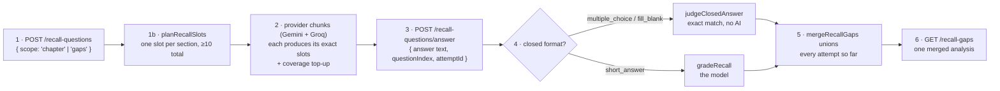

> The session's *before* score is the **mean of every recall attempt**, exactly
> as the retest's *after* is the mean of its answers — so the delta stays one
> comparable number whichever mode was chosen. (`mergeRecallGaps`,
> `spreadByFocus`, `focusSubset` in `apps/server/src/routes/study.ts`.)

**Part B — Answer each question:**

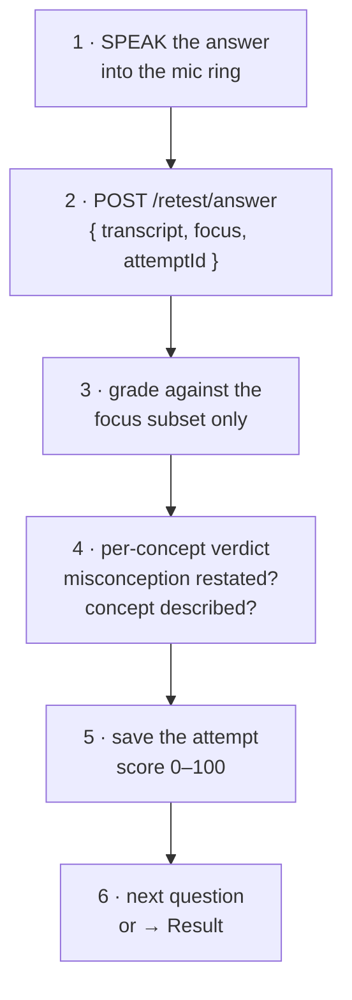

> **Trace:** speak → submit → grade the focus only → verdict → save + score →
> next question.

```
Sending:   { transcriptText, focus: ["..."], attemptId }
Receiving: { score: 100, gaps: { covered, missing, misconceptions, score } }
```

---

### 5.8 Result — "see your improvement"

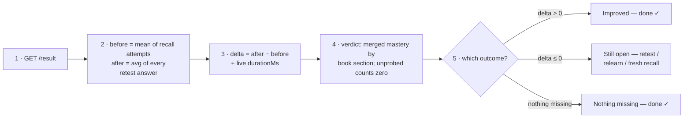

> **Trace:** fetch result → compute the metrics → derive the verdict → pick the
> outcome → suggest the next move. After two consecutive no-improvement rounds,
> the app suggests coming back later.

```
Receiving: { before: 60, after: 85, delta: 25, durationMs: 124000,
             verdict: { passed: false, overall: 68, threshold: 70,
                        unprobedSections: 1,
                        sections: [ { key: "2.1", label: "2.1",
                                      score: 82, probed: true }, ... ] } }
Data kept: nothing — reads earlier attempts and the chapter checklist
```

> **Why a verdict on top of the delta.** "The score went up" is not "this would
> pass". `retest-verdict.ts` merges mastery from every attempt (retest answers
> override recall for the same idea), groups the chapter by the book's own
> sections, and weights each idea by its concept weight: mastered earns full,
> partial earns half, a misconception or an unjudged idea earns nothing.
> Unprobed ideas stay in the denominator, and a pass requires **no section
> unprobed** at **≥70%**. The result UI shows the per-section breakdown so a
> skipped lesson reads as "not checked", never as mastered. The dashboard list
> deliberately omits the verdict (it would cost a checklist read per card); only
> the session result carries it.

---

### 5.9 Session end — "I'm done"

The session ends two ways: a button tap or a spoken farewell.

**Path A — Button ("Done for now"):**

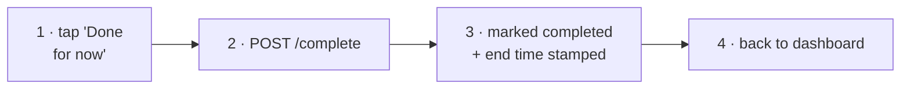

> **Trace:** tap → complete → stamp → dashboard. Unknown session ids get a
> **404**, so a stale "complete" can never blow up a fresh session.

**Path B — Spoken farewell:**

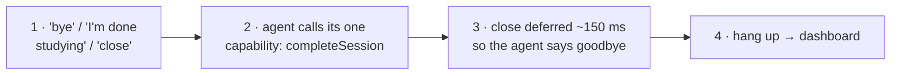

> **Trace:** hear the farewell → one tool call → speak the goodbye → leave. If
> the microphone is mid-answer (a recall being captured), the farewell is **NOT**
> treated as "end session" — it finalizes the answer instead.

```
Sending:   POST /sessions/{id}/complete
Receiving: { ok: true, durationMs: 53659 }
Data kept: study_session UPDATE (status = "completed", completedAt = now)
```

---

### 5.10 Voice capture — the push-to-talk ring

The ring is the one entry point for an answer, spoken or typed. When the
student is signed in and the browser supports speech (Chrome `SpeechRecognition`
via the `lib/voice.ts` seam, wrapped in `useVoiceSession`), tapping the ring
captures what they say; everything spoken is transcribed on-device through the
browser's speech service and submitted as text. The recall and retest loops
grade against that text — the voice layer never grades, and the on-screen loop
remains the single source of truth. Demo guests and unsupported browsers see a
clear "voice is for signed-in students" / unsupported label and the typed
recorder instead.

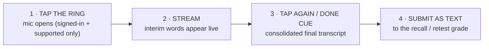

> **Trace:** tap → listen → finalize → submit text. Same seam covers the
> explicit "Read it to me" read-back and the lesson narration via `speakAloud`.

---

### 5.11 Natural voice read-back — the lesson reads itself (on tap)

When a lesson arrives it offers to read itself aloud so the student can follow
both the text and the voice:

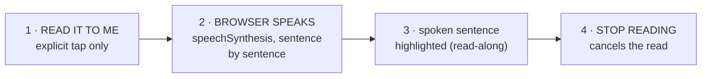

> **Trace:** tap → browser TTS → highlight → stop on demand. The browser voice
> is never automatic — it only runs from the explicit button, and a read is cut
> off if the student leaves the screen mid-sentence.

The browser voice (`speakAloud`) picks the least robotic English voice
available and reads at a slightly relaxed pace. A safety beat also keeps it
alive through Chrome's known "paused speech" stall, so a long lesson never
stops mid-sentence.

---

### 5.12 End-of-speech detection — auto-submit without a tap

While the student speaks, the browser watches their transcript for boundary
phrases:

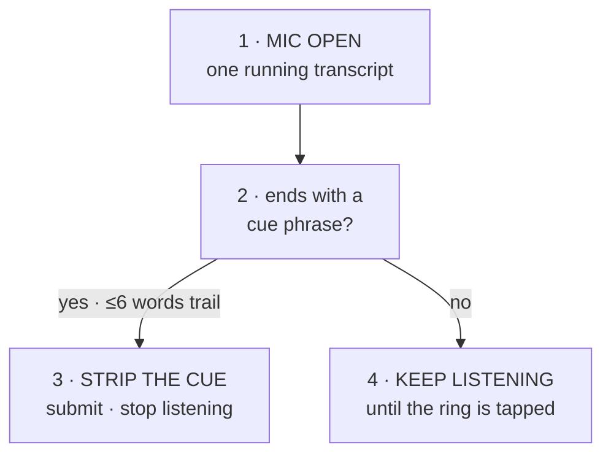

> **Trace:** listen → check for the cue → either submit or keep listening. The
> submitted text is the student's answer; the cue phrase itself is removed
> before submission. (16 cues total — "that's all I remember", "I'm done", "next
> question", ... — defined in `apps/web/src/lib/intent.ts`.)

---

### 5.13 The database — what gets saved

The study domain uses **five tables**, and one row of each means:

| Table | One row = | Key columns |
|---|---|---|
| `textbook` | A real textbook that **belongs to a user** (e.g. "Physics") | `ownerId` (→ user), `title`, `subject`, `language` |
| `chapter` | One chapter in a textbook, with its text | `textbookId`, `title`, `rawText` |
| `concept_node` | One idea (or misconception) in the checklist | `chapterId`, `conceptText`, `isMisconception`, `weight` |
| `study_session` | One study attempt on a chapter | `chapterId`, `userId` (→ user), `status`, `startedAt`, `completedAt`, `retestQuestions` (JSON), `retestIndex` |
| `attempt` | One measurement inside a session: the recall, or one retest answer | `id` (client `attemptId`), `sessionId`, `stage`, `transcriptText`, `gapsIdentified` (JSON: `mastery` per-concept levels + the three lists derived from them + `estimated`), `score` |

*Why `retestQuestions` and `retestIndex` exist:* if the student reloads
mid-retest, the server can rebuild the exact question they were on and restore
their answered list — instead of dumping them back into a cold recall. Auth
adds four more tables (`user`, `session`, `account`, `verification`) — see [the database sector](database.md).

What each action writes:

- **Chapter ingest** → `textbook` (1) + `chapter` (1) + `concept_node` (5–12) +
  `chapter_objective` (0–15, when the book states objectives)
- **Start session** → `study_session` (1)
- **Recall** → `attempt` (1, stage `"recall"`)
- **Retest answer** → `attempt` (1, stage `"retest"`)
- **Complete** → `study_session` UPDATE (status, completedAt)
- **Microlesson, retest questions, result, history** → nothing (pure AI
  generation or reads)

---

### 5.14 AI prompts — what gets sent to Gemini

Every AI call follows the same shape: one system prompt plus the student's
data, sent as a single message with `temperature: 0.4` and JSON output. Seven
different things get asked:

1. **EXTRACT** (chapter ingest) — "Pull the core concepts + common
   misconceptions from this chapter, and transcribe the learning objectives the
   book itself states" → `{items: [{conceptText, weight, isMisconception}],
   objectives: [{objectiveText}]}`. One call returns both, because the free
   tier is per *project*: a chapter read costs one request whether it yields one
   list or two. A chapter that states no objectives returns an empty array, not
   invented ones.
2. **GRADE** (recall + retest) — "Judge how well the student's explanation
   covers the checklist" → `{covered: [], missing: [], misconceptions: [],
   score}`. The chapter's subject is passed so family-specific directives
   (from `subject-strategy.ts`) are injected into the system prompt.
3. **LESSON** (microlesson) — "Write a short, pronunciation-friendly lesson
   that fixes exactly these gaps" → `{text}`. Also receives the subject and
   injects family directives.
4. **RECALL QUESTIONS** (targeted / both modes) — a *diagnostic* writer
   (`generateRecallQuestions`): "Ask short questions that reveal this student's
   gaps and wrong beliefs" → `{questions: [{format, question, options, answer,
   level, targetConcept, targetObjective}]}`. Low-pressure on purpose — mostly
   factual taps and blanks, never framed as an exam (`recallLevelDirective`
   differs from the retest's hard standard). One shared taxonomy
   (`apps/server/src/ai/questions.ts`) tags every question with a cognitive
   level, and the same file fixes the **format** mix per set (5/2/1, or 3/4/1
   for blank-heavy subjects). The mix is enforced three ways: a provider JSON
   schema guarantees `format` and its fields; `enforceRecallMix` re-spaces the
   spoken answers so two never sit in a row; and the no-model fallback builds
   closed questions from the chapter's own text (blank a concept out of a
   sentence, other concepts as the wrong options). Grading: multiple choice and
   fill-in-the-blank by exact match with no model call, short answer via the
   model. An unanswerable closed question is downgraded to `short_answer` at
   parse time.
5. **RETEST** (exam-readiness) — a *separate* writer (`generateRetestQuestions`):
   "Write questions that prove a student is bulletproof" → `{questions:
   [{question, level, targetConcept, targetObjective, beyondText}]}`. Must never
   be easy, must include fine detail, must climb all five cognitive levels, and
   must include at least one `beyondText` scenario. Receives the chapter's
   stated objectives so it can hold the student to the author's own contract.
   This reversed the old behaviour where the retest echoed the student's recall
   wording. A set that comes back too soft (fewer than three levels, or no
   beyond-text question) is counted and logged via `retestIsSoft`.
6. **FOCUS** (per-question verdict) — a deterministic helper, not a prompt: a
   misconception counts as handled when *not* restated; a real concept counts
   when covered. Applied to the question's focus subset only.
7. **WHY-FIRST** (plan orienting lines) — one batched call writes a short
   "why this step is yours" line per plan step, from concept + failure mode +
   student's own words. Subject + family directives included.

Grading never trusts the AI's own number: the model returns per-concept
*levels* and nothing else, and the score is recomputed deterministically
server-side from those levels plus the concept weights. A level that is
out-of-range, non-numeric, or keyed to something not on the checklist is
dropped — a sloppy response degrades to the older list-based behaviour rather
than throwing. And every prompt has a fallback: if Gemini fails or the key is a
placeholder, deterministic heuristics take over (token matching for grading,
sentence splitting for concepts, an objectives-heading scan for learning
objectives, templates for lessons/questions), flagged with `estimated: true`.
The question fallback is not a stub: retest falls back to spoken explanations of
the failed ideas, and recall rebuilds the closed format mix offline — it finds a
chapter sentence naming a concept, blanks the concept out, and uses other
chapter concepts as the wrong options — so an offline student still taps and
types rather than only speaking.

**Subject-family directives.** `apps/server/src/ai/subject-strategy.ts` defines
`SubjectFamily` (11 values: mathematics, physics, chemistry, biology,
english_languages, history_social, geography, economics_business, cs_ict,
general_science, other) and `getPhaseDirectives(family, phase)` which returns
terse system-prompt bullets and client-hint strings per phase. The chapter's
`subject` is resolved via `chapterSubject(chapterId)` in `study.ts` and passed
into `gradeRecall`, `generateMicroLesson`, `generatePlanWhyFirst`,
`generateGuideSection`, and `generateRetestQuestions`. A mirrored client copy
(`apps/web/src/lib/subject-strategy.ts`) powers the recall/retest phase hints.

---

### 5.15 Complete data flow map — every request

Every API request in the product, who makes it, and whether it touches the AI
or the database. **All of these require a signed-in session** — see [authentication](auth.md) for how
that works:

| Endpoint | Called by | AI? | DB write? |
|---|---|---|---|
| `POST /api/auth/*` | Sign-in / sign-up / session | no | yes (auth tables) |
| `GET /api/chapters` | Dashboard | no | no |
| `GET /api/chapters/:id/concepts` | (view only) | no | no |
| `GET /api/chapters/:id/objectives` | (view only) | no | no |
| `POST /api/chapters/ingest` | Admin / seed | yes | yes |
| `POST /api/sessions/start` | Dashboard | no | yes |
| `GET /api/sessions` | Dashboard (history) | no | no |
| `GET /api/sessions/:id` | StudyProvider | no | no |
| `POST /api/sessions/:id/recall` | StudyProvider | yes | yes |
| `POST /api/sessions/:id/microlesson` | StudyProvider | yes | no |
| `POST /api/sessions/:id/recall-questions` | StudyProvider (targeted/both) | yes | yes |
| `POST /api/sessions/:id/recall-questions/answer` | StudyProvider | only short answer (MCQ/blank are deterministic) | yes |
| `GET /api/sessions/:id/recall-gaps` | StudyProvider | no | no |
| `PATCH /api/sessions/:id/recall-mode` | StudyProvider | no | yes (update) |
| `POST /api/sessions/:id/retest` | StudyProvider | yes | no |
| `POST /api/sessions/:id/retest/answer` | StudyProvider | yes | yes |
| `GET /api/sessions/:id/result` | StudyProvider | no | no |
| `POST /api/sessions/:id/complete` | UI + voice agent | no | yes (update) |

The key insight: **the browser UI owns the whole study loop.** The only thing
the voice agent can do is `completeSession` — one endpoint, one job. The
server doesn't care who sent the request.

---
